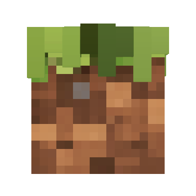
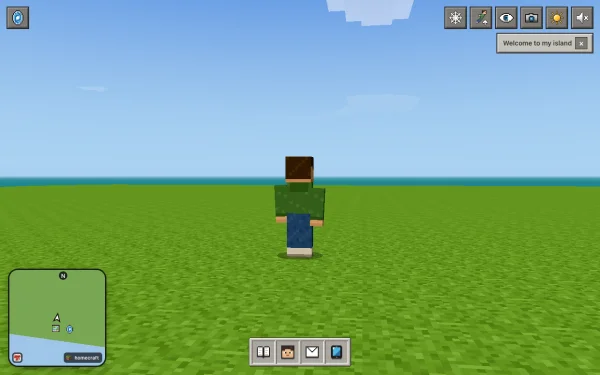

<p align="center">
  
</p>

<h1 align="center">Homecraft Plugins</h1>

<p align="center">
  <strong>The plugin system for Homecraft, a Minecraft-inspired 3D personal website template.</strong>
</p>

<p align="center">
  <a href="README.md">中文</a> · <b>English</b> · <a href="https://github.com/terryHu7/homecraft">Homecraft</a>
</p>

## Catalog

<!-- catalog:start -->
| [Welcome (Example)](plugins/welcome/) (terryHu7) |
| :---: |
| <a href="plugins/welcome/"></a> |
<!-- catalog:end -->

## Installation

Standard plugins install into `world/plugins/<id>/` (with optional server code in `backend/<id>/`) and are enabled through `home.config.js`, leaving `engine/` untouched across upgrades.

Select a plugin from the catalog and have your coding agent follow its `AGENTS.md`, or install it through the CLI (see the [installation guide](AGENTS.md#installing-a-plugin-into-a-homecraft-site)):

```sh
npx --yes github:terryHu7/homecraft-plugins add <id> --site <site-dir>
```

## Submission [🔗 Open PR](https://github.com/terryHu7/homecraft-plugins/compare)

Each plugin lives in `plugins/<id>/` with a `plugin.json` manifest, a user-facing `README.md`, an agent-facing `AGENTS.md`, a `LICENSE` file, and an `index.js` entry module (for standard plugins).

Follow the [submission guide](CONTRIBUTING.md) to update the registry, run local checks, and open a pull request (one plugin per PR). Once merged, the plugin appears in the catalog above.
