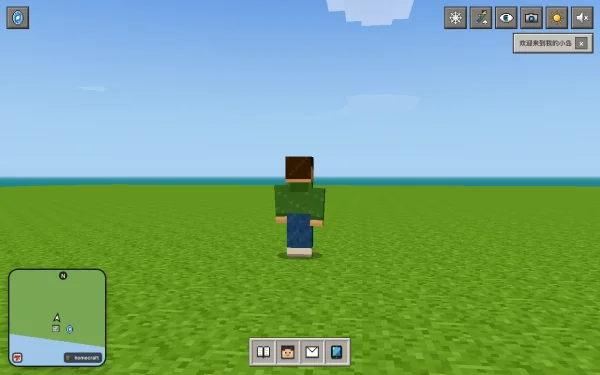

  

<h1 align="center">Homecraft Plugins</h1>

  <strong><a href="https://github.com/terryHu7/homecraft">Homecraft</a> 插件系统，用于扩展「我的世界」风格的 3D 个人网站。</strong>

  <b>中文</b> · <a href="README.en.md">English</a>

## 插件目录

<!-- catalog:start -->
| [欢迎横幅（示例）](plugins/welcome/) (terryHu7) |
| :---: |
|  |
<!-- catalog:end -->

## 安装插件

从目录中选择插件，按插件目录下的 `AGENTS.md` 安装，或通过 [CLI](AGENTS.md#installing-a-plugin-into-a-homecraft-site) 安装。

## 提交插件

将插件放入 `plugins/<id>/`（需包含 `README.md` 与 `AGENTS.md`），按[提交说明](AGENTS.md#authoring-and-submitting-a-plugin)通过 [Pull Request](https://github.com/terryHu7/homecraft-plugins/compare) 申请收录。合入后可在目录中找到插件与使用说明。
