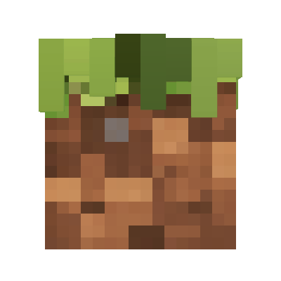

<p align="center">
  
</p>

<h1 align="center">Homecraft Plugins</h1>

<p align="center">
  <strong>Homecraft 插件系统，用于扩展「我的世界」风格的 3D 个人网站。</strong>
</p>

<p align="center">
  <b>中文</b> · <a href="README.en.md">English</a> · <a href="https://github.com/terryHu7/homecraft">Homecraft</a>
</p>

## 插件目录

<!-- catalog:start -->
| [欢迎横幅（示例）](plugins/welcome/) (terryHu7) |
| :---: |
| <a href="plugins/welcome/"></a> |
<!-- catalog:end -->

## 安装插件

标准插件安装至站点的 `world/plugins/<id>/` 目录（可选后端代码位于 `backend/<id>/`），通过 `home.config.js` 启用，不修改核心引擎，兼容后续升级。

从目录中选择插件，交由 AI 编程助手按对应目录下的 `AGENTS.md` 完成接入，或通过 CLI 安装（详见[安装说明](AGENTS.md#installing-a-plugin-into-a-homecraft-site)）：

```sh
npx --yes github:terryHu7/homecraft-plugins add <id> --site <site-dir>
```

## 提交插件 [🔗 提交 PR](https://github.com/terryHu7/homecraft-plugins/compare)

每个插件独立存放于 `plugins/<id>/`，需包含清单 `plugin.json`、面向使用者的 `README.md`、面向 AI 助手的 `AGENTS.md`、协议文件 `LICENSE`，以及入口模块 `index.js`（标准插件）。

请遵循[提交指南](CONTRIBUTING.md)运行目录同步与校验命令后提交 Pull Request（每次 PR 仅包含一个插件），合入后即在目录中展示。
