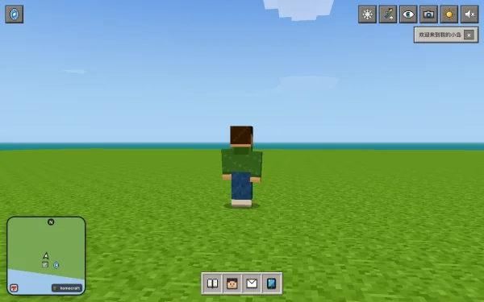

# Welcome (Example) / 欢迎横幅（示例）

> [!NOTE]
> Minimal example for testing the plugin system. Not a real feature plugin.<br>
> 仅用于测试插件系统的示例，非正式插件。

Displays a dismissible bilingual greeting below the top-right controls. Runs entirely in the browser with no external requests or data persistence.<br>
在页面右上角按钮下方显示可关闭的双语欢迎提示。纯前端运行，无外部网络请求，不持久化访客数据。

| 中文 | English |
| :---: | :---: |
|  |  |

## Installation / 安装

See [AGENTS.md](AGENTS.md), or install via CLI:

```sh
npx --yes github:terryHu7/homecraft-plugins add welcome
```

## Options / 配置项

| Option | Type | Default | Description |
| --- | --- | --- | --- |
| `en` | `string` | `"Welcome to my island"` | English greeting / 英文提示 |
| `zh` | `string` | `"欢迎来到我的小岛"` | Chinese greeting / 中文提示 |
| `dismissible` | `boolean` | `true` | Show a close button / 是否显示关闭按钮 |
